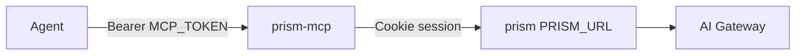

# prism-mcp

This file is the guide for any coding agent and any contributor. Follow it.

## What this project is

`@skyphusion/prism-mcp` is the MCP door for the Prism playground API.
It is a stateless Streamable-HTTP Worker.
It proxies curated tools to a prism host (`PRISM_URL`).
This repo holds the implementation.
Deploy config is Wrangler plus secrets.

The version is root `package.json`.
Do not copy a version into this file.
See `CHANGELOG.md` and the latest `prism-mcp-v*` tag.

The tool catalog is `export const TOOLS` in `src/mcp-tools.ts`.
Re-count there if you need a number.
The license is MIT.
Prism itself stays AGPL.

This package talks to [prism](https://github.com/skyphusion-labs/prism).
It does not call [prism-control-plane](https://github.com/skyphusion-labs/prism-control-plane) itself.
If the prism session has a `pcp_` key in prefs, prism may spend through that plane.
Native clients are [prism-ios](https://github.com/skyphusion-labs/prism-ios) and [prism-android](https://github.com/skyphusion-labs/prism-android).
Read each repo for its version.

The first-party Worker is `https://prism-mcp.skyphusion.org`.
A self-host uses the Wrangler template below.

## How to work

```bash
npm run typecheck
npm test
npm run test:coverage
npm run build
```

Typecheck is the CI gate.
Run it before you push.
CI is [.github/workflows/ci.yml](.github/workflows/ci.yml).

Public docs are [README.md](README.md), [docs/mcp.md](docs/mcp.md), and [docs/PARITY.md](docs/PARITY.md).

## Deploy

npm publish runs on a `prism-mcp-v*` tag.
See `.github/workflows/publish-npm.yml`.
The tag must match `package.json`.
The tag must be an ancestor of `main`.

The Worker deploy uses the same tag track.
See `.github/workflows/deploy.yml`.
Pin the package.
Set `main` to `dist/mcp.js`.
Set secrets `MCP_TOKEN` and `PRISM_SESSION`.
Set var `PRISM_URL`.
The template is `wrangler.mcp.toml.example`.
Steps are in [docs/mcp.md](docs/mcp.md).

Confirm live `/health` and `tools/list`.
A green CI run is not the live Worker.

## Load-bearing rules

The agent presents `MCP_TOKEN`.
The Worker forwards the prism session cookie.
The prism cookie never leaves the Worker.
There are no prism bindings.
The call is plain HTTP to `PRISM_URL`.
The Worker is stateless.
The agent polls `poll_job` and `poll_import` for long jobs.
One tool maps to one route, plus the read and write escape hatches.
`prism_request` is a write-only alias of the write hatch.
Live WebSocket STT (`/api/stt/stream`) is out of scope.



## Versions

A version changes only in a release pull request.
Feature and fix pull requests do not bump it.
Put the tag on that pull request's merge commit.
The version of record is `package.json`.
The tag shape is `prism-mcp-v*`.
If that version already has a tag, the cycle is closed.
The next release pull request bumps.
If the manifest version has no tag, stop.
Find why before you bump again.

## Docs

Write Simplified Technical English.
Use short sentences.
Use one idea per sentence.
Use the active present tense.
Use plain words.
Use the same word every time.

Do not use an em dash (U+2014) or an en dash (U+2013).
Use a comma, a semicolon, parentheses, or two hyphens (`--`).

State the limit next to the capability.
Do not turn a measured result into a promise.
Use Conventional Commits.
Pull requests target `main`.
CI must pass.

## Safety

Do not put a secret in a tracked file.
Do not put a secret in a log.
Do not put a secret in an issue.
